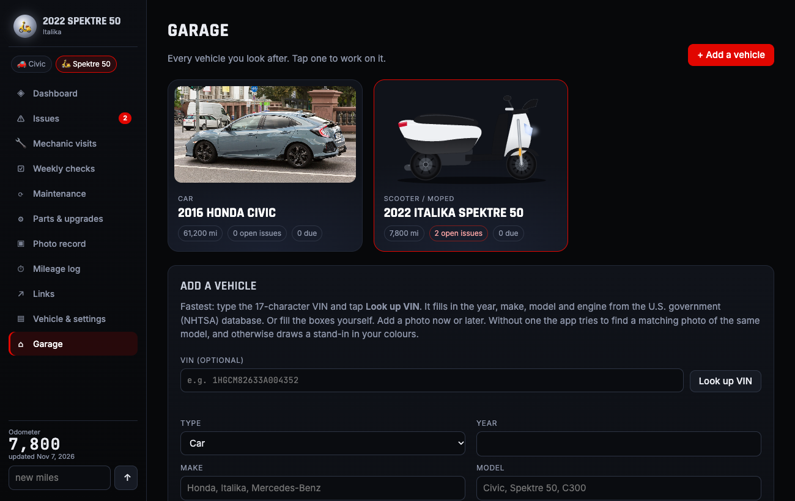
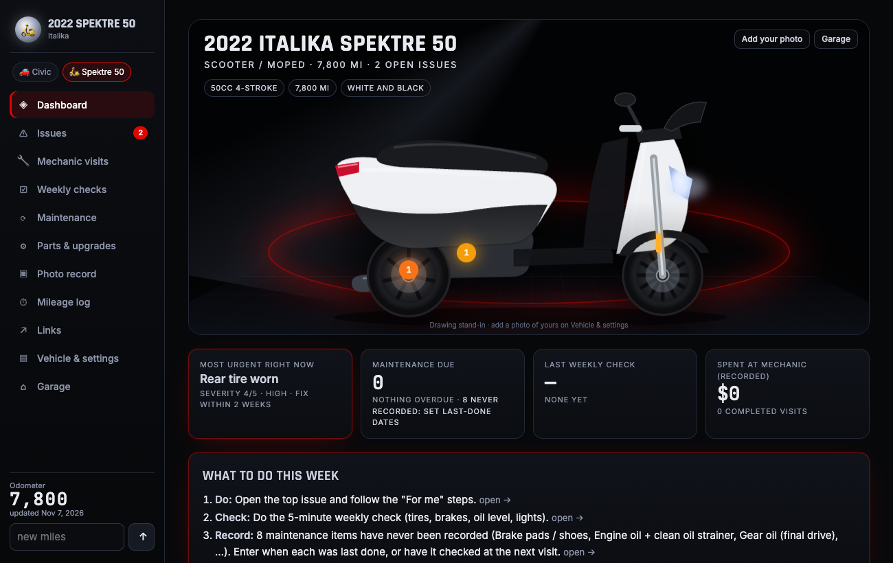
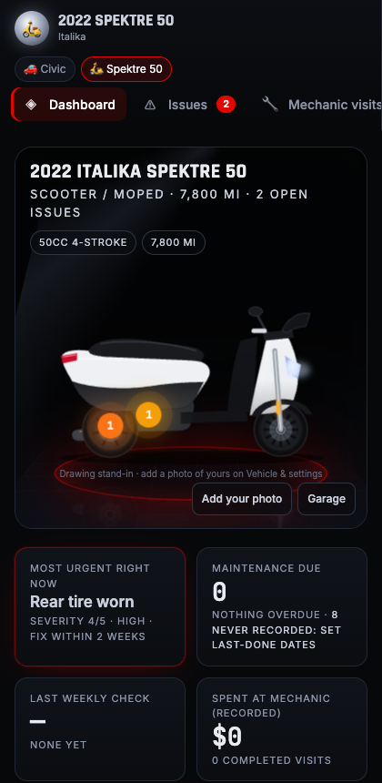
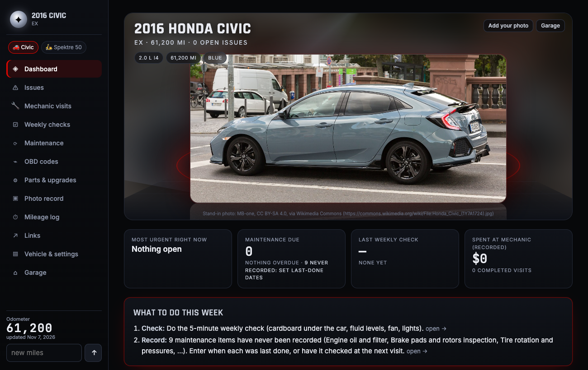

# Open Garage

A self-hosted maintenance log for the vehicles you own: cars, SUVs, motorcycles and scooters.
One PHP app, one SQLite file, no framework and no build step. It's built for the owner rather than the mechanic:
it tells you what to do this week, keeps the history a shop can't argue with, and makes the car look good doing it.



## What it does

- **Add a vehicle in a minute.** A three-step wizard: pick the year, make and model from lists (or scan the **VIN**, decoded
  with the free U.S. NHTSA database), snap a photo, then tap what's going on ("oil change due", "tire worn",
  "check engine light"...). Each answer becomes an issue with plain-language next steps.
- **Showroom photo.** Your photo is cut out of its background and rendered as a "3D photo" that tilts with your phone or
  mouse, on a lit stage with a reflection. This uses the optional [garage-vision](vision/) service on any machine with a
  GPU. Without it you get your photo on the stage; without a photo, a matching freely licensed stand-in photo
  (Wikimedia Commons, credited) or a drawing in your vehicle's colours, with issue markers on it.
- **Experimental 3D model** from one photo (TripoSR), and full 3D view if you supply a `.glb` model.
- **Issues** with severity, "for me" and "for the mechanic" guidance, notes over time, photos, and the visit that
  caused them. **Mechanic visits:** plan the work, print a brief for the shop, record what was done, cost and before/after
  photos, and sign it off.
- **Maintenance schedule** by miles and months (starter schedules for cars and for scooters/motorcycles), weekly
  check-lists, mileage log, parts list, OBD-II code library, links.
- **One owner or many.** Run it for yourself with one password, or as a hosted service with email sign-up
  (`MULTI_USER`): every account sees only its own vehicles, with password reset by email, per-account limits, sign-up
  throttling and a JSON export of your data.
- **Diagnose any check-engine code, any car.** Type codes, paste a scan report, or upload a PDF/CSV export or a
  photo of the scanner screen (read by a local vision model on the optional [garage-vision](vision/) service, and
  always shown back for confirmation). For each code: plain meaning, "can I drive it?", typical cost and DIY
  difficulty, ranked causes, try-this-first steps, what to tell the shop, and for mechanics the set criteria and a
  test plan. Across codes it reasons about combinations (both banks lean, misfire + lean, U-code storms, fix-first
  order), reads freeze-frame / live data (fuel trims, coolant temp, MAF vs engine size, voltage, "codes cleared
  recently"), adds well-known failure patterns for specific engines and transmissions, NHTSA recalls and owner
  complaints for the model, and repair videos. Built-in knowledge covers the SAE generic codes by family
  (O2 sensors per bank/sensor, misfire per cylinder, VVT, EVAP, transmission solenoids, network U-codes...) and
  explains any other code by its structure. VINs from any country are identified (NHTSA vPIC plus a worldwide
  manufacturer/country table).
- **DIY and Mechanic modes.** Mechanic mode adds customers, their vehicles, saved diagnostic reports per customer,
  and printable reports. **My tools** keeps the paid services you already use (ALLDATA, ProDemand, Identifix, scan
  tool clouds, factory service sites) one tap away, each opening in its own window; results come back by upload,
  paste, or the phone's Share sheet (the installed app is a share target).
- **Shop management (Mechanic mode).** Repair orders from estimate to paid: services built from labor (hours ×
  rate), parts (cost → sell price through a tiered markup matrix), fees, sublet and core charges; shop supplies with a
  cap, separate parts/labor/fee tax, discounts, gross profit and effective labor rate. ~55 canned jobs with typical
  labor times (and your own), a parts catalog with stock levels and CSV import, and a parts finder that searches your
  catalog and opens supplier searches for the exact vehicle (RockAuto, AutoZone, O'Reilly, NAPA, FCP Euro, eBay,
  Autodoc...). Customers approve or decline each service from a link and sign with their name; every authorization is
  recorded (who, when, how, how much) and the order warns before exceeding it (e.g. California's 10% / $100 rule).
  Multi-point vehicle inspection (green/yellow/red) feeding the estimate, part status (quoted/ordered/received),
  concern/cause/correction, printable estimate, technician work order and invoice, payments (recorded, not processed),
  a shop board with sales, average repair order, effective labor rate, closing ratio and money owed, and one-tap
  "estimate from diagnosis".
- **Repair videos in the app** (YouTube Data API key in `YOUTUBE_KEY`; without it the Videos tab opens YouTube).
- **Try it without an account** (hosted mode): guest garages that expire after `GUEST_DAYS` unless kept, and a
  public code lookup page (`?p=lookup`), both rate-limited.
- **Health score.** One number (0-100) per vehicle with the reasons behind it: open problems by severity, overdue
  service, recalls to check, active warning codes, a stale weekly check. Each reason links to the fix.
- **Safety recalls.** Every vehicle is checked against the U.S. NHTSA recall database once a week (free, no key).
  New recalls show as a banner; mark each one fixed or "doesn't apply to mine" after checking your VIN.
- **Share your service record.** One read-only link (or a printed PDF) with the service history, mechanic visits,
  odometer readings and recalls, for a mechanic or a buyer. You choose whether it shows costs, open problems and the
  full VIN; turn it off any time. It never shows your name, email or your own photos.
- **Weekly reminder email** (hosted mode): one email a week, only when something is due; one-click opt-out.
- **Phone-first and private.** On a phone it is an app: bottom tab bar, a big ＋ for quick entries (problem, service
  done, photos, mileage), installable to the home screen with an offline screen. Photos are re-encoded on upload
  (location data stripped) and only ever streamed to their owner.

| Stand-in drawing (no photo yet) | On a phone |
|---|---|
|  |  |



## Run it

Requirements: PHP 8.2+ with `pdo_sqlite`, `gd` (photos), `curl` (VIN lookup and stand-in photos); optionally `exif`
and ImageMagick or libheif (iPhone HEIC photos).

```bash
git clone https://github.com/krintoxi/open-garage.git && cd open-garage
./run.sh            # http://localhost:8300 , then add your first vehicle
```

On a server, point the web root at this folder (`index.php` is the only entry point) and copy
`app/config.local.example.php` to `app/config.local.php`. There you keep the database and photos outside the web root,
and choose the mode:

- **Just you:** leave `MULTI_USER` off and set the password from the server: `php app/tools/set-password.php`.
  Until a password exists the app only answers requests from the machine itself.
- **A hosted garage for others:** `define('MULTI_USER', true);` plus `BASE_URL`, and `MAIL_KEY` / `MAIL_FROM` (a
  [Resend](https://resend.com) key) for confirmation and password-reset emails. The first account to sign up is the admin.
- **Showroom photos / 3D:** run [vision/](vision/) on a GPU machine and set `VISION_URL` / `VISION_TOKEN`.
- **In-app video search:** `define('YOUTUBE_KEY', '...');` (a free YouTube Data API v3 key; results are cached a week).
- **Reminder emails (hosted mode):** run `php app/tools/send-reminders.php` once a day from cron (`--dry-run` shows
  who would get what). Each account gets at most one email a week, and none when nothing is due.

## Notes

- Internal PHP files refuse direct requests, and `app/.htaccess` / `uploads/.htaccess` deny them on Apache. On other
  servers, block `/app`, `/data` and `/uploads` too.
- Outbound requests: `vpic.nhtsa.dot.gov` and `commons.wikimedia.org` when you add a vehicle or look up a VIN, and
  `api.nhtsa.gov` (year/make/model only, never the VIN) for recalls, owner complaints and model names, and
  `googleapis.com` for video search when a key is set.
- The OBD-II library covers the standard generic codes; add your own notes and codes from the OBD codes page.
- 3D: see [assets/models/README.txt](assets/models/README.txt). No 3D model is included.
- Screenshot credit: the Honda Civic stand-in photo is by MB-one, CC BY-SA 4.0, via Wikimedia Commons.

## License

MIT, see [LICENSE](LICENSE).
